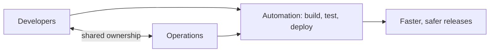
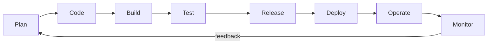

# 01 - DevOps Basics

> What DevOps is, what Docker is, and why Docker exists.

## Table of Contents
- [What is DevOps?](#what-is-devops)
- [The DevOps lifecycle](#the-devops-lifecycle)
- [Key DevOps practices](#key-devops-practices)
- [What is Docker?](#what-is-docker)
- [The need for Docker](#the-need-for-docker)
- [Summary](#summary)

---

## What is DevOps?

**DevOps = Development + Operations.**

It is a **culture and a set of practices**, not a single tool. The goal is to make the people who *write* software (Dev) and the people who *deploy and run* it (Ops) work as one team, so software is built, tested and released **faster and more reliably**.

### The problem DevOps solves

Before DevOps, the two teams worked in silos:

```
 Developers                         Operations
┌──────────────┐                  ┌──────────────┐
│ Write code   │ ──── throw ────► │ Deploy & run │
│ "Works on    │      over the    │ "It broke in │
│  my machine" │       wall       │  production" │
└──────────────┘                  └──────────────┘
      ^                                  │
      └──────── blame, delays ───────────┘
```

- Releases were slow and risky (every few months).
- Environments differed, so bugs appeared only in production.
- Nobody owned the whole journey from code to customer.

### With DevOps



---

## The DevOps lifecycle

DevOps is often drawn as an infinite loop, because software is never "done": you keep planning, building, releasing and learning from production.



| Stage | What happens | Example tools |
|---|---|---|
| Plan | Decide what to build | Jira, Trello |
| Code | Write and version code | Git, GitHub |
| Build | Compile and package the app | npm, Maven, **Docker** |
| Test | Automated tests | Jest, Selenium |
| Release | Prepare a versioned release | GitHub Releases |
| Deploy | Ship to servers | Kubernetes, Ansible |
| Operate | Run the app in production | Cloud (AWS, Azure) |
| Monitor | Track errors and performance | Prometheus, Grafana |

---

## Key DevOps practices

| Practice | Meaning |
|---|---|
| **CI (Continuous Integration)** | Every push is automatically built and tested |
| **CD (Continuous Delivery/Deployment)** | Passing builds are automatically released to staging or production |
| **Infrastructure as Code (IaC)** | Servers and setup are defined in files (Terraform), not clicked together by hand |
| **Containerization** | Package the app with its dependencies so it runs the same everywhere (**Docker**) |
| **Monitoring and logging** | Know when and why something breaks in production |
| **Collaboration** | Dev and Ops share responsibility |

### A typical CI/CD pipeline


Docker fits in the middle: it is the **packaging step** that makes the build identical on every machine.

---

## What is Docker?

**Docker is an open-source platform that lets you package an application and everything it needs (runtime, libraries, config) into a standardized unit called a *container*, which runs the same way on any machine.**

### Is Docker a tool or a tech stack?

| | Tech stack | Docker |
|---|---|---|
| Example | MERN (MongoDB, Express, React, Node) | Docker |
| Purpose | What you build the app **with** | What you **package and run** the app with |

Docker is a **tool/platform**, not a tech stack. It works with *any* stack.

### What "Docker" actually includes

| Piece | Role |
|---|---|
| Docker Engine | The background service that builds and runs containers |
| Docker CLI | The `docker` command you type |
| Docker Desktop | GUI app for Windows/Mac that bundles everything |
| Docker Hub | Public registry to share and download images |

---

## The need for Docker

### 1. "It works on my machine" problem

```
 Developer laptop            Test server              Production
┌────────────────┐        ┌───────────────┐       ┌───────────────┐
│ Node 20        │        │ Node 16       │       │ Node 14       │
│ Windows        │        │ Ubuntu        │       │ CentOS        │
│ Works!         │        │ Fails         │       │ Crashes       │
└────────────────┘        └───────────────┘       └───────────────┘
```

Different OS, runtime versions and libraries cause different behavior.

### With Docker: same container everywhere

```
 Developer laptop            Test server              Production
┌────────────────┐        ┌───────────────┐       ┌───────────────┐
│ [ Container ]  │        │ [ Container ] │       │ [ Container ] │
│ app + Node 20  │  ===   │ app + Node 20 │  ===  │ app + Node 20 │
│ + libraries    │        │ + libraries   │       │ + libraries   │
└────────────────┘        └───────────────┘       └───────────────┘
        Same image  ->  same behavior everywhere
```

### 2. Dependency conflicts

Project A needs Node 14 and Project B needs Node 20. Installing both globally on one machine is painful. With Docker, each app lives in its own container with its own versions, fully isolated.

### 3. Fast onboarding

Without Docker: install Node, Postgres, Redis, set env variables, fix version mismatches (hours or days).
With Docker: `docker compose up` (minutes).

### 4. Lightweight compared to VMs

Containers share the host kernel, so they start in seconds and use far less RAM than full virtual machines.

### 5. Easy scaling and deployment

Need more capacity? Start more containers from the same image. Rolling back is just running the previous image version.

### 6. Fits CI/CD perfectly

The same image that passed tests is the one that gets deployed, so there are no surprises between stages.

### Summary of benefits

| Problem | How Docker helps |
|---|---|
| Environment differences | Same image runs everywhere |
| Dependency conflicts | Each app isolated in its own container |
| Slow setup | One command to start the whole stack |
| Heavy VMs | Lightweight, starts in seconds |
| Hard deployments | Ship the image, not instructions |
| Scaling | Run more containers from the same image |

---

## Summary

- **DevOps** is a culture and set of practices that unites development and operations through automation (CI/CD, IaC, monitoring, containers).
- **Docker** is a tool/platform for packaging apps into containers that run identically anywhere.
- Docker exists to kill "works on my machine", avoid dependency conflicts, speed up setup, and make deployment and scaling simple.
