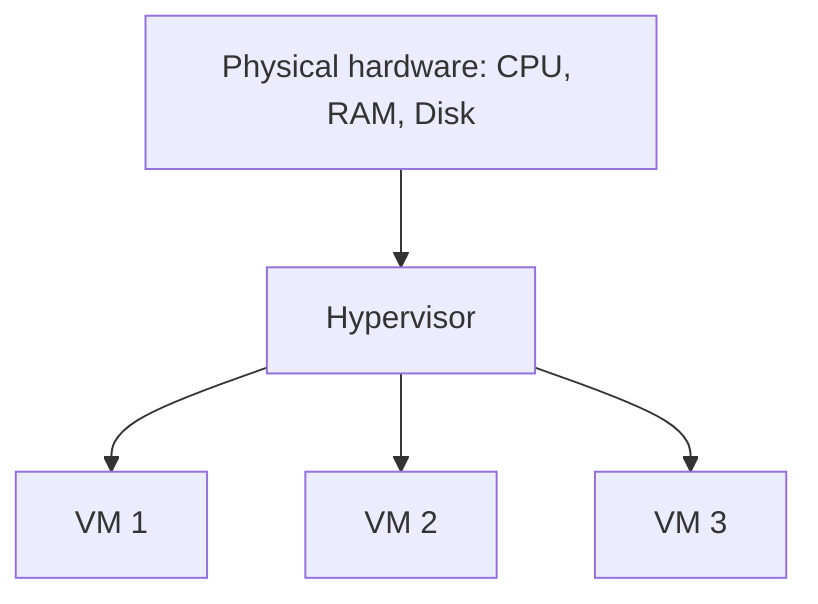
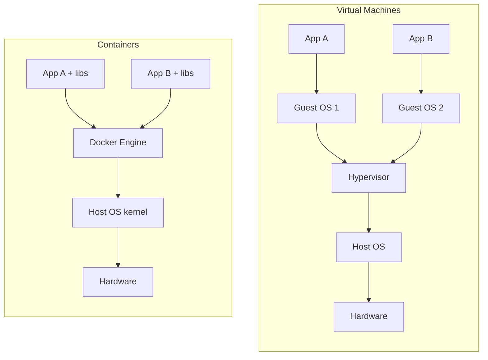

# 02 - Virtual Machines vs Containers

> How VMs and containers differ, what a hypervisor is, and how both work on Windows.

## Table of Contents
- [Core idea](#core-idea)
- [What is a hypervisor?](#what-is-a-hypervisor)
- [Virtual machines](#virtual-machines)
- [Containers](#containers)
- [Side-by-side architecture](#side-by-side-architecture)
- [Comparison table](#comparison-table)
- [On Windows: both cases](#on-windows-both-cases)
- [When to use which](#when-to-use-which)
- [Summary](#summary)

---

## Core idea

> **VMs virtualize hardware. Containers virtualize the OS.**

To *virtualize* means to give software a **fake, isolated version** of a resource so it believes it has the real thing to itself. The difference is **which layer is faked**.

---

## What is a hypervisor?

A **hypervisor** is software that lets one physical machine run several isolated virtual machines by splitting up its CPU, RAM and storage.



| Type | Runs on | Examples |
|---|---|---|
| **Type 1 (bare metal)** | Directly on hardware | VMware ESXi, Hyper-V (server), KVM |
| **Type 2 (hosted)** | On top of a normal OS | VirtualBox, VMware Workstation |

---

## Virtual machines

Each VM is a **whole computer inside your computer**. The hypervisor presents fake hardware (virtual CPU, RAM, disk, network card), and you install a **complete guest OS with its own kernel** on it.

```
┌─────────────────────────────────────────┐
│ App                                     │
│ Libraries / binaries                    │
│ Guest OS (own kernel)  <- full OS boot  │
│ Virtual hardware       <- faked by      │
│                           hypervisor    │
└─────────────────────────────────────────┘
```

**The VM thinks:** "I am a whole computer."

Characteristics:
- Resources (RAM, CPU, disk) are allocated up front.
- Boots like a real machine (minutes).
- Strong isolation, since each VM has its own kernel.
- Can run any OS (Linux VM on Windows, and so on).

---

## Containers

A container packages **only the app and its dependencies** and runs as an **isolated process** on the **host's kernel**. Nothing fakes hardware, and no second OS is booted.

Two Linux kernel features create the isolation:

| Feature | Controls | Example |
|---|---|---|
| **Namespaces** | What a container can **see** | Own process list (PID 1), own network, own filesystem, own hostname |
| **cgroups** | What a container can **use** | Limits on CPU and memory |

```
┌─────────────────────────────────────────┐
│ App + its libraries    (per container)  │
│ Container isolation    <- namespaces +  │
│                           cgroups       │
│ Shared host kernel                      │
└─────────────────────────────────────────┘
```

**The container thinks:** "I am the only thing running on this OS." In reality it is a normal process wrapped in walls.

Characteristics:
- Starts in seconds (no OS to boot, just a process to launch).
- Small (MBs, not GBs).
- Uses resources on demand.
- Lighter isolation, since all containers share one kernel.

---

## Side-by-side architecture



The key visual difference: each VM carries its **own guest OS**, while containers **share one kernel**.

### Analogy

- **VM = separate houses.** Each has its own foundation, plumbing and wiring.
- **Container = apartments in one building.** Each has a private locked space, but they share the building's foundation and utilities.

---

## Comparison table

| | Virtual Machine | Container |
|---|---|---|
| What is virtualized | Hardware | OS (process view) |
| Includes | Full OS + app | App + dependencies only |
| Kernel | One per VM | Shared with host |
| Size | GBs | Usually MBs |
| Startup | Minutes | Seconds or less |
| Resource use | Heavy, fixed up front | Light, on demand |
| Isolation | Strong | Lighter (shared kernel) |
| Managed by | Hypervisor | Container runtime (Docker Engine) |
| Density per machine | Few | Dozens or hundreds |
| Portability | Heavy images | Small, portable images |

---

## On Windows: both cases

### Case 1: VM on Windows

Install a hypervisor (Hyper-V, VirtualBox or VMware Workstation), create a VM and install a guest OS such as Ubuntu inside it.

```
Your App
Ubuntu (guest OS, own kernel)
Virtual hardware (fake CPU, RAM, disk)
Hypervisor
Windows (host OS)
Physical hardware
```

### Case 2: Containers on Windows

Docker containers share the host's **kernel**, and most containers are **Linux** containers. Windows has a different kernel, so it cannot run them directly.

**Docker Desktop solves this with WSL 2**, which runs a lightweight Linux VM with a real Linux kernel. Your containers run inside it.

```
Container A    Container B    Container C
Docker Engine
Linux kernel (WSL 2 lightweight VM)
Hypervisor (Hyper-V technology)
Windows (host OS)
Physical hardware
```

So on Windows, containers are not completely VM-free: there is **one small shared Linux VM**, and all containers live inside it. It is managed for you and is far lighter than one VM per app.

### Side by side on Windows

| | VM approach | Docker approach |
|---|---|---|
| Setup | Install hypervisor + full guest OS | Install Docker Desktop (WSL 2 handled) |
| 3 Linux apps | 3 VMs, 3 kernels, GBs of RAM | 3 containers, 1 shared kernel |
| Startup | Minutes | Seconds |
| RAM | Fixed up front | On demand |

> **Note:** Windows also supports native *Windows containers* (for .NET Framework apps and similar), which share the Windows kernel. They are niche; most web development uses Linux containers.

### See it yourself

Once Docker is installed, run a container and then list processes inside WSL (`ps aux`). The container's process shows up like any other, proving it is just an isolated process and not a separate machine.

---

## When to use which

| Use a VM when you need... | Use a container when you need... |
|---|---|
| A different full OS or kernel | To package and ship an app quickly |
| Strong isolation (untrusted workloads) | Many lightweight, isolated services |
| To run legacy or full-OS software | Consistent dev/test/prod environments |
| Hardware-level separation | Fast startup and easy scaling (microservices, CI/CD) |

They are not rivals: in practice they **work together**. Cloud servers are often VMs, and containers run inside those VMs.

---

## Summary

- A **hypervisor** splits hardware to run multiple VMs.
- **VM** = fake hardware + full guest OS + app. Heavy, strongly isolated.
- **Container** = app + dependencies as an isolated process sharing the host kernel (via namespaces and cgroups). Light and fast.
- On **Windows**, Docker containers run on the Linux kernel inside a lightweight WSL 2 VM.
- **VMs virtualize hardware, containers virtualize the OS.**
