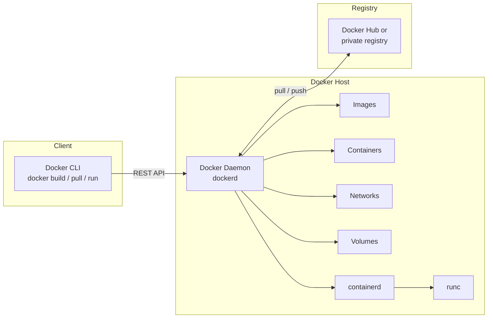
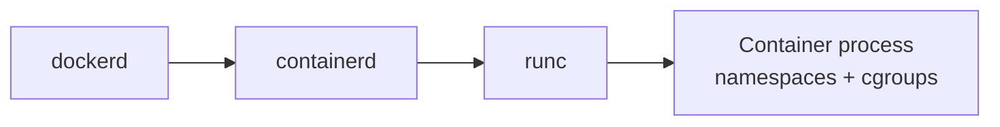
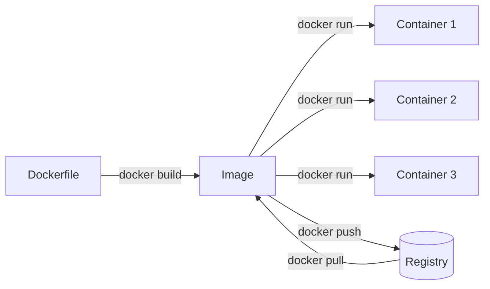
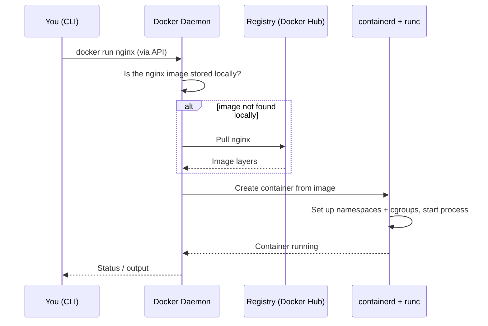

# 03 - Docker Architecture

> The client-server model, core components, Docker objects, and what happens when you run a container.

## Table of Contents
- [Overview: client-server model](#overview-client-server-model)
- [Core components](#core-components)
- [Docker objects](#docker-objects)
- [Dockerfile to Image to Container](#dockerfile-to-image-to-container)
- [Image layers](#image-layers)
- [What happens on `docker run nginx`](#what-happens-on-docker-run-nginx)
- [Ecosystem tools](#ecosystem-tools)
- [Try it yourself](#try-it-yourself)
- [Summary](#summary)

---

## Overview: client-server model

Docker uses a **client-server architecture**. When you type a command you are not creating containers directly. You are sending a request to a background service (the **daemon**) that does the work.



The client and daemon can be on the same machine, or on different machines (for example your laptop controlling a remote server).

---

## Core components

### 1. Docker Client
The `docker` CLI (`docker run`, `docker build`, `docker ps`). It converts your command into **REST API calls** and sends them to the daemon.

### 2. Docker Daemon (`dockerd`)
The **brain**. It runs in the background, listens for API requests and manages all Docker objects: images, containers, networks and volumes. It also talks to registries.

### 3. containerd and runc (low-level runtime)
The daemon delegates the actual work:

| Component | Role |
|---|---|
| **containerd** | Manages the container lifecycle (start, stop, image transfer, storage) |
| **runc** | Creates the container process using Linux **namespaces** and **cgroups** |



### 4. Docker Registry
A storage and distribution service for images.

| Registry | Notes |
|---|---|
| **Docker Hub** | Default public registry |
| AWS ECR, GitHub Container Registry, GitLab Registry | Common private or company registries |

- `docker pull` downloads an image from a registry.
- `docker push` uploads an image to a registry.

---

## Docker objects

These are the things the daemon creates and manages.

| Object | What it is |
|---|---|
| **Dockerfile** | Text file of step-by-step instructions to build an image |
| **Image** | Read-only template containing the app, dependencies and config, built in layers |
| **Container** | A running instance of an image (an isolated process) |
| **Volume** | Persistent storage that survives container deletion (for example database data) |
| **Network** | Lets containers talk to each other and the outside world |

---

## Dockerfile to Image to Container



**Analogy:** an image is like a **class** and a container is like an **object** created from it. You can start many containers from one image.

---

## Image layers

An image is built from stacked, read-only **layers**, one per Dockerfile instruction. When a container starts, Docker adds a thin **writable layer** on top.

```
┌───────────────────────────────┐
│ Writable container layer      │  <- changes made while running
├───────────────────────────────┤
│ COPY . .       (app code)     │  read-only
├───────────────────────────────┤
│ RUN npm install               │  read-only
├───────────────────────────────┤
│ COPY package.json .           │  read-only
├───────────────────────────────┤
│ FROM node:20  (base image)    │  read-only
└───────────────────────────────┘
```

Why layers matter:
- Layers are **cached**, so unchanged steps are not rebuilt (faster builds).
- Layers are **shared** between images, which saves disk space and download time.


---

## What happens on `docker run nginx`



Step by step:
1. The **client** sends the request to the **daemon** through the API.
2. The daemon checks whether the `nginx` image exists locally.
3. If not, it **pulls** it from the **registry**.
4. The daemon asks **containerd** to create a container from the image.
5. **runc** sets up namespaces and cgroups and starts the process.
6. The container is running, and status goes back to the client.

---

## Ecosystem tools

| Tool | Purpose |
|---|---|
| **Docker Compose** | Define and run multi-container apps (for example Node API + Postgres + Redis) from one `docker-compose.yml` |
| **Docker Desktop** | GUI app for Windows/Mac bundling the engine, CLI, Compose and WSL 2 setup |
| **Docker Swarm / Kubernetes** | Orchestration: running containers across many machines |

---

## Summary

- Docker is **client-server**: the CLI talks to the daemon over a REST API.
- The **daemon (`dockerd`)** manages images, containers, networks and volumes, and delegates to **containerd**, which uses **runc** to create containers.
- **Registries** (Docker Hub) store and distribute images.
- Flow to remember: **Dockerfile -> (build) -> Image -> (run) -> Container**.
- Images are built from cached, shareable **layers**.
