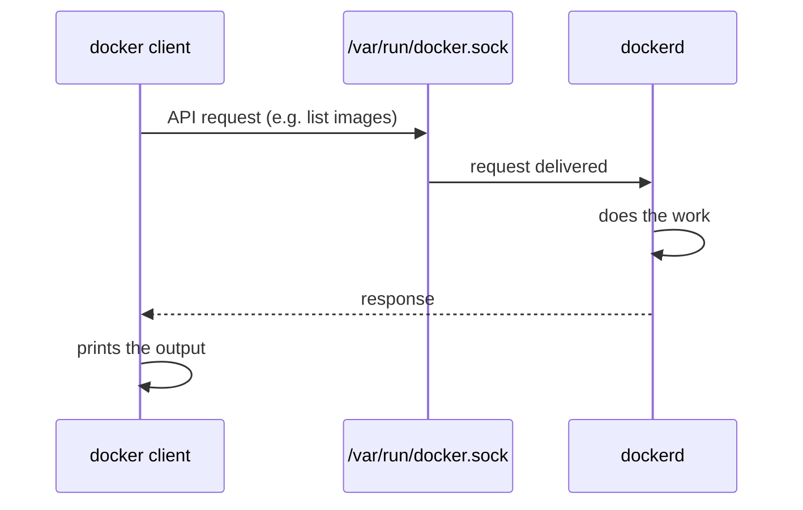

# Installing Docker

Two ways I set up Docker:

1. Locally using Docker Desktop
2. On an AWS EC2 instance, connected through SSH from PowerShell

---

## 1. Locally (Docker Desktop)

1. Download Docker Desktop for Windows and install it (keep the WSL 2 option enabled).
2. Start Docker Desktop and wait until the engine shows as running.
3. Check it in PowerShell:

```powershell
docker --version
docker run hello-world
```

---

## 2. AWS EC2 instance (SSH from PowerShell)

Connect to the instance:

```powershell
ssh -i "path\to\key.pem" ubuntu@<EC2-public-IP>
```

After connecting, run these commands one by one:

```bash
sudo apt update
sudo apt install docker.io
sudo systemctl status docker
docker
docker images
```

### What each command does

| Command | Purpose |
|---|---|
| `sudo apt update` | Refreshes the package list so the latest available versions are known. Installs nothing by itself. |
| `sudo apt install docker.io` | Installs Docker (the `dockerd` daemon and the `docker` CLI). `sudo` is needed because installing needs root access. |
| `sudo systemctl status docker` | Checks whether the Docker service is running. It should show `active (running)`. Press `q` to exit. |
| `docker` | Prints the help text and list of commands. Confirms the Docker client is installed. |
| `docker ps` | Lists the running containers on your machine. Empty on a fresh install. |
| `docker images` | Lists the images stored locally. Empty on a fresh install. |

---

## Error: permission denied

Running `docker ps` gives:

```
permission denied while trying to connect to the Docker daemon socket at unix:///var/run/docker.sock
```

**Reason:** the `docker` command has to connect to the daemon through the socket file `/var/run/docker.sock`. Only `root` and members of the `docker` group can access that file, and my user is neither.

**Solution:** add the user to the `docker` group.

```bash
sudo usermod -aG docker $USER
newgrp docker
```

| Part | Meaning |
|---|---|
| `usermod` | Modifies a user account |
| `-a` | Append to the existing groups instead of replacing them |
| `-G docker` | The group to add the user to |
| `$USER` | Holds the current username (must be uppercase, `$user` won't work) |
| `newgrp docker` | Applies the new group in the current shell without logging out |

After this, `docker images` works without `sudo`.

---

## How the Docker client interacts with dockerd

Docker works as a client and a server:

- **Client:** the `docker` command I type
- **Server:** `dockerd`, the daemon running in the background

The client doesn't create containers itself. It converts the command into an API request and sends it to `dockerd` through the socket `/var/run/docker.sock`. `dockerd` does the actual work and sends the result back, and the client prints it.



This is also why the permission error above happens: the request has to pass through the socket file first, and without access to it the connection fails.
