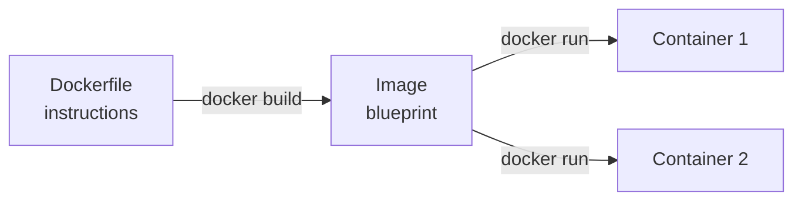
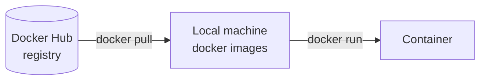
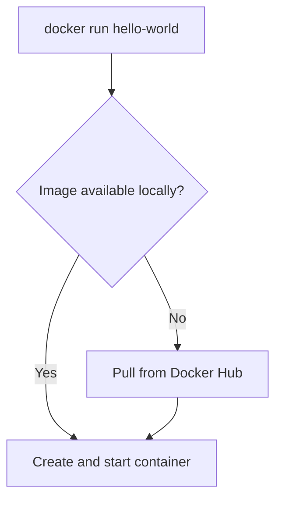
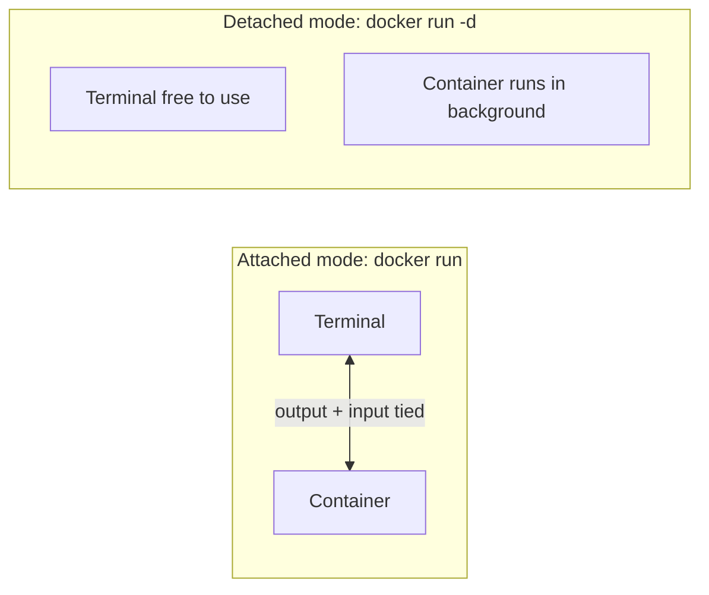

# Docker Images

## Table of Contents
- [What is an image?](#what-is-an-image)
- [Dockerfile, image, container](#dockerfile-image-container)
- [Pulling prebuilt images](#pulling-prebuilt-images)
- [docker login](#docker-login)
- [Example 1: hello-world](#example-1-hello-world)
- [Example 2: mysql](#example-2-mysql)
- [Problem: the container blocks the terminal](#problem-the-container-blocks-the-terminal)
- [Detached mode](#detached-mode)
- [Stopping a container](#stopping-a-container)
- [Commands used](#commands-used)

---

## What is an image?

An image is the **blueprint** that holds the environment and dependencies (OS libraries, runtime, app code, config) needed to run a container. It is read-only. The container is what you get when you actually run that blueprint.

Images are built from stacked read-only **layers**, one per instruction in the Dockerfile. That is why they download and rebuild quickly, since unchanged layers are reused.

```
┌──────────────────────────┐
│ app code                 │  layer
├──────────────────────────┤
│ dependencies             │  layer
├──────────────────────────┤
│ runtime (e.g. Node)      │  layer
├──────────────────────────┤
│ base OS files            │  layer
└──────────────────────────┘
        = Image (read-only)
```

---

## Dockerfile, image, container



| Term | Meaning |
|---|---|
| **Dockerfile** | Text file with the instructions to build an image |
| **Image** | The blueprint created from those instructions |
| **Container** | A running instance of the image |

One image can start many containers (like one class, many objects).

I don't always have to build images myself. Prebuilt images can simply be **pulled** from a registry.

---

## Pulling prebuilt images

A **registry** is a place where images are stored and shared. The default one is **Docker Hub**.



```bash
docker pull <image_name>
docker images            # lists images stored locally
```

`docker images` output looks like this:

```
REPOSITORY    TAG      IMAGE ID       CREATED        SIZE
hello-world   latest   d2c94e258dcb   1 year ago     13.3kB
```

| Column | Meaning |
|---|---|
| REPOSITORY | Name of the image |
| TAG | Version label of the image (`latest` is the default if none is given) |
| IMAGE ID | Unique ID of the image |
| CREATED | When the image was built (not when it was downloaded) |
| SIZE | Disk size of the image |

When I write `docker pull mysql`, Docker actually reads it as `docker.io/library/mysql:latest` (registry / namespace / name : tag).

---

## docker login

```bash
docker login
```

It asks for a **username** and **password** of the Docker Hub account.

If I don't remember the password, I can use a **PAT (Personal Access Token)** instead. It is generated from Docker Hub (Account settings, then Personal access tokens) and pasted in the password field. A PAT is also safer than the real password because it can be revoked anytime without changing the account password.

Once logged in, the machine is authenticated with Docker Hub.

Extra info:
- Pulling **public** images (hello-world, mysql, nginx) works even without logging in. Login matters for **pushing** images, pulling **private** repositories, and getting higher pull-rate limits.
- Docker saves the login in `~/.docker/config.json`, so I don't have to log in again every time.

---

## Example 1: hello-world

```bash
docker pull hello-world
docker run hello-world
```

- `docker pull hello-world` downloads the image from Docker Hub.
- `docker run hello-world` creates a container from it and runs it. It prints a welcome message and then **exits**.

I can also skip the pull and directly run:

```bash
docker run hello-world
```

If the image isn't available locally, `docker run` automatically pulls it first and then runs it.



`hello-world` stops by itself because its only job is to print a message. After it exits, it won't show in `docker ps`, but it will in `docker ps -a`.

---

## Example 2: mysql

```bash
docker pull mysql
```

MySQL is a **server**, not a one-time program like hello-world. It needs configuration before it starts, such as a password for the root user. That is passed as an **environment variable** using `-e`:

```bash
docker run -e MYSQL_ROOT_PASSWORD=root mysql
```

| Part | Meaning |
|---|---|
| `docker run` | Create and start a container |
| `-e` | Set an environment variable inside the container |
| `MYSQL_ROOT_PASSWORD=root` | Variable name and value: the root password is `root` |
| `mysql` | The image to use |

Without that variable, the mysql container refuses to start and exits with an error, because it needs a password (or another auth option) defined. `root` as a password is only fine for practice, not for anything real.

---

## Problem: the container blocks the terminal

After running `docker run -e MYSQL_ROOT_PASSWORD=root mysql`, the terminal fills with MySQL logs and I can't type anything else. This is because the container is running in **attached (foreground) mode**: the container's output is connected to my terminal, and the terminal stays occupied until the container stops.

Pressing `Ctrl + C` stops the container too, since it is tied to that terminal.

For servers that must keep running (MySQL, nginx, a Node API), this is not practical. So the fix is to always run them in **detached mode**.

---

## Detached mode

**Detached mode** means the container runs in the **background**. Docker starts it, prints the container ID, and gives the terminal back immediately. The container keeps running even though I'm not watching it.

```bash
docker run -d image_name
```

`-d` stands for detached. For the mysql example:

```bash
docker run -d -e MYSQL_ROOT_PASSWORD=root mysql
```



| | Attached (default) | Detached (`-d`) |
|---|---|---|
| Terminal | Blocked while container runs | Free immediately |
| Logs | Shown live in terminal | Not shown (see `docker logs`) |
| Closing/Ctrl+C | Stops the container | Container keeps running |
| Good for | Quick tests, debugging | Servers and long-running services |

Since the logs don't show anymore in detached mode, I can still read them anytime:

```bash
docker logs container_id
```

To confirm the container is running in the background:

```bash
docker ps
```

---

## Stopping a container

If a container is running in attached mode and the terminal is blocked, connect to the instance again in a **new PowerShell tab** (a second SSH session) and stop it from there:

```bash
docker ps                      # find the container ID
docker stop container_id
```

`docker stop` stops a running container. It first asks the process to shut down gracefully (SIGTERM), and if the process doesn't exit within about 10 seconds, Docker force-kills it.

I can use just the first few characters of the ID as long as they are unique, for example `docker stop a1b2`.

A stopped container isn't deleted. It still exists and shows up in `docker ps -a`. To delete it:

```bash
docker rm container_id
```

To delete a image(images consumes disk space i.e EBS on EC2 instance):

```bash
docker rmi image_id or name
```

check how much space is used now in docker:

```bash
docker system df
```

check how much space is used now in machine(-h: in human readable form):

```bash
df -h
```

clear out other unused leftovers:

```bash
docker system prune
```

---

## Commands used

| Command | Purpose |
|---|---|
| `docker images` | List images stored locally |
| `docker login` | Log in to Docker Hub (username + password or PAT) |
| `docker pull image_name` | Download an image from the registry |
| `docker run image_name` | Create and start a container from an image (pulls the image if missing) |
| `docker run -e VAR=value image_name` | Run a container with an environment variable |
| `docker run -d image_name` | Run a container in detached (background) mode |
| `docker ps` | List running containers |
| `docker ps -a` | List all containers, including stopped ones |
| `docker logs container_id` | Show the output of a container |
| `docker stop container_id` | Stop a running container |
| `docker rm container_id` | Remove a stopped container |
