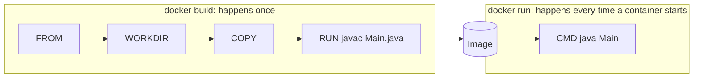
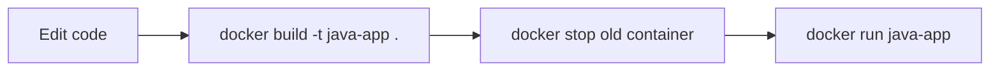
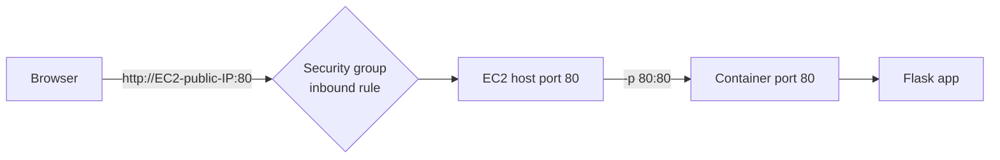

# Dockerfile and Running Containers

## Table of Contents
- [1. Setting up the project](#1-setting-up-the-project)
- [2. Writing the Dockerfile (Java example)](#2-writing-the-dockerfile-java-example)
- [3. Two ways to compile the code](#3-two-ways-to-compile-the-code)
- [4. Why CMD and RUN? (build time vs run time)](#4-why-cmd-and-run-build-time-vs-run-time)
- [5. Saving, checking and editing the Dockerfile](#5-saving-checking-and-editing-the-dockerfile)
- [6. Build the image and run the container](#6-build-the-image-and-run-the-container)
- [7. When the code changes](#7-when-the-code-changes)
- [8. Example 2: Flask app](#8-example-2-flask-app)
- [9. Checking a running container](#9-checking-a-running-container)
- [10. Containers that stop immediately](#10-containers-that-stop-immediately)
- [11. Commands used](#11-commands-used)

---

## 1. Setting up the project

On the EC2 instance:

```bash
mkdir projects            # create a folder for the work
cd projects
git clone <github-repo-url>
cd <repo-name>            # git clone creates a folder named after the repo
rm Dockerfile             # remove the existing Dockerfile (if the repo has one)
vim Dockerfile            # create a new one
```

- `mkdir` creates a folder.
- `git clone url` downloads the project from GitHub into a new folder.
- `rm Dockerfile` deletes the old Dockerfile. `rm` deletes permanently with no recycle bin, so make sure it's the right file.
- `vim Dockerfile` opens (or creates) the file in the vim editor.

---

## 2. Writing the Dockerfile (Java example)

A Dockerfile is read from top to bottom, and each instruction is one build step.

```dockerfile
FROM eclipse-temurin:17-jdk

WORKDIR /app

COPY src/Main.java /app/Main.java

RUN javac Main.java

CMD ["java", "Main"]
```

| Instruction | What it does |
|---|---|
| `FROM image:tag` | The **base image** to start from. It already contains the tools and libraries needed (here a Java JDK). Format is `FROM image-name:image-tag(version)`. |
| `WORKDIR /app` | Creates the folder `/app` inside the container (if missing) and makes it the working directory. Every later instruction runs from here. |
| `COPY source dest` | Copies files from the host machine (the build folder) into the image. |
| `RUN command` | Runs a command **while building** the image. Here it compiles the code. |
| `CMD [...]` | The command that runs when a **container starts** from the image. |

Notes from my own attempts:
- I first used `openjdk:17-jdk-alpine`, which has two problems: the word is spelled **alpine** (not "alphine"), and the `openjdk` image on Docker Hub is deprecated. A tag I tried (`eclipse-temurin:17-jdk-alpine`) also came back "not found", so I switched to `eclipse-temurin:17-jdk`, which worked. If a `FROM` line fails with "not found", the tag doesn't exist, so check the available tags on Docker Hub.
- **`CMD ["java", "Main"]` needs a space between `CMD` and `[`.** Writing `CMD["java","Main"]` gave `unknown instruction: CMD["java","Main"]`.

---

## 3. Two ways to compile the code

**Option A: copy the whole project, compile with the path**

```dockerfile
COPY . .
RUN javac src/Main.java
```

`COPY . .` copies everything from the host folder (first `.`) into the working directory of the container (second `.`). The compiled `Main.class` is created **next to the source**, so it ends up in `/app/src/`. Because of that, `CMD ["java", "Main"]` wouldn't find it. It would need:

```dockerfile
CMD ["java", "-cp", "src", "Main"]
```

(`-cp` is the classpath: where Java should look for classes.)

**Option B: copy just the one file**

```dockerfile
COPY src/Main.java /app/Main.java
RUN javac Main.java
CMD ["java", "Main"]
```

Here `Main.class` ends up directly in `/app`, which is also the working directory, so the plain `CMD ["java", "Main"]` works. This is the version I used.

---

## 4. Why CMD and RUN? (build time vs run time)



**RUN** and the other build instructions (`FROM`, `COPY`) are used to **build the image**. They run once, during `docker build`.

**CMD** doesn't run during the build at all. It is stored in the image as the **default command** and executes when a container is started from that image.

Layers:
- The build steps that change files (`FROM`, `COPY`, `RUN`) each create a **layer** of the image. Instructions like `WORKDIR` and `CMD` mostly just store settings in the image.
- That's why the build output shows "Step 1/5", "Step 2/5", and so on, with intermediate containers created and removed for the `RUN` steps.
- Layers are cached, so if only the last steps change, Docker reuses the earlier layers and the rebuild is faster.

### CMD can be overridden

The command in `CMD` is only a default. Anything written after the image name in `docker run` replaces it:

```bash
docker run java-app                 # runs the default: java Main
docker run java-app echo hello      # CMD is replaced, so it just prints hello
```

### ENTRYPOINT

`ENTRYPOINT` is similar to `CMD`, since it also defines what runs when a container starts and doesn't run at build time. The difference is that extra words after the image name are **not** treated as a replacement. They are added as arguments to the entrypoint:

```dockerfile
ENTRYPOINT ["java", "Main"]
```

```bash
docker run java-app hello      # runs: java Main hello
```

It can still be replaced, but only deliberately with the `--entrypoint` flag, so in everyday use it behaves as "can't be overridden".

| | RUN | CMD | ENTRYPOINT |
|---|---|---|---|
| Runs when | Image is **built** | Container **starts** | Container **starts** |
| Purpose | Install, compile, set up | Default command or default arguments | The fixed main command |
| Override at `docker run` | Not applicable | Yes, just write another command | Only with `--entrypoint`; plain arguments are appended |
| Creates image layer | Yes | No (stored as a setting) | No (stored as a setting) |

---

## 5. Saving, checking and editing the Dockerfile

In **vim**:
1. Press `i` to enter insert mode, then type or paste the content.
2. Press `Esc` to leave insert mode.
3. Type `:wq` and press Enter to **w**rite (save) and **q**uit. Use `:q!` to quit without saving.

Check the file:

```bash
cat Dockerfile           # print the file in the terminal
```

Make changes later (nano is easier than vim):

```bash
nano Dockerfile          # Ctrl+O then Enter to save, Ctrl+X to exit
```

---

## 6. Build the image and run the container

```bash
docker build -t java-app .
docker run java-app
```

| Part | Meaning |
|---|---|
| `docker build` | Build an image from a Dockerfile |
| `-t java-app` | **t**ag: gives the image the name `java-app` |
| `.` | The **build context**, i.e. the current folder. Docker sends it to the daemon and the Dockerfile's `COPY` takes files from here. The Dockerfile is expected in this folder |
| `docker run java-app` | Create and start a container from the image, which executes the `CMD` |

The build prints a "legacy builder is deprecated" warning. It's only a notice and the build still works.

---

## 7. When the code changes

A container is created from the image **as it was when built**. Editing the source file on the host doesn't change an existing image or running container. So after any change:



```bash
docker build -t java-app .
docker stop <container_id>        # only if the old one is still running
docker run java-app
```

The image must be rebuilt, and a new container must be created from it. Old stopped containers can be removed with `docker rm`.

---

## 8. Example 2: Flask app

### Dockerfile

```dockerfile
FROM python:3.12-slim

WORKDIR /app

COPY requirements.txt .
RUN pip install -r requirements.txt

COPY . .

EXPOSE 80

CMD ["python", "app.py"]
```

- `requirements.txt` is copied and installed **before** the rest of the code. Dependencies change rarely, so Docker can reuse that cached layer and rebuilds stay fast when only the code changes.
- `EXPOSE 80` only documents which port the app uses. It doesn't open anything by itself.

### Build and run

```bash
docker build -t flask-app .
docker run -d -p 80:80 flask-app
```

| Part | Meaning |
|---|---|
| `-d` | Detached: run in the background, terminal stays free |
| `-p 80:80` | Port mapping in the form **host-port:container-port** |



The first number is the port on the EC2 machine, the second is the port inside the container. For example, `-p 8080:80` means "open `http://IP:8080` on the host and send it to port 80 in the container".

### It didn't open on the public IP

Things that can block it, and the fixes:

1. **EC2 security group:** by default only SSH (22) is open. Add an **inbound rule** for the host port (for example 80, type HTTP or Custom TCP) on the running instance. This was my fix. No restart is needed.
2. **App listening address:** Flask by default listens only on `127.0.0.1`, which is unreachable from outside the container even with the port mapped. The app must listen on all interfaces:

```python
app.run(host="0.0.0.0", port=80)
```

3. **Port mismatch:** the container port in `-p` must be the port the app actually listens on. If the app runs on 5000, use `-p 80:5000`.
4. **Use `http://`**, not `https://`, since no certificate is set up.

### Errors I hit while doing this

| Error | Cause | Fix |
|---|---|---|
| `Could not find a version that satisfies the requirement flask==3.1.1` | The Dockerfile used `python:3.7`, but Flask 3.1.1 needs Python 3.9 or newer | Use a newer base image such as `python:3.12-slim` |
| `jinja2.exceptions.TemplateNotFound: index.html` | Flask looks for HTML files in a folder named `templates` next to `app.py`; the file wasn't there (or the name or case was wrong), or it was added after the image was built | Put `index.html` inside `templates/` and rebuild the image |

Also, the error page I saw was Flask's debug page. Debug mode on a public IP is risky, so turn it off (`debug=False`) once testing is done.

---

## 9. Checking a running container

```bash
docker ps                          # find the container ID
docker logs container_id           # print the logs so far
docker logs -f container_id        # keep following the logs live (Ctrl+C stops following only)
docker attach container_id         # connect the terminal to the container's main process
docker exec -it container_id bash  # open an interactive shell inside the running container
```

| Command | What it does | Note |
|---|---|---|
| `docker logs` | Shows everything the container has printed | Safe, doesn't affect the container |
| `docker logs -f` | Same, but continues streaming new lines | Press `Ctrl+C` to stop watching. The container keeps running |
| `docker attach` | Attaches your terminal to the container's main process, so the output shows continuously | Pressing `Ctrl+C` here can stop the container itself. To leave safely, use `Ctrl+P` then `Ctrl+Q` (works for containers started with `-it`). `docker logs -f` is the safer way to watch logs |
| `docker exec -it` | Runs a **new** command inside a running container | Used to get a shell and look around or work inside it |

`exec` flags: `-i` keeps input open and `-t` gives a terminal, so together `-it` makes an interactive session.

Example with MySQL, to get into the database from inside its container:

```bash
docker exec -it container_id bash
mysql -u root -p                   # then type the root password
```

or in one step:

```bash
docker exec -it container_id mysql -u root -p
```

Alpine-based images don't include `bash`, so use `sh` instead (`docker exec -it container_id sh`).

---

## 10. Containers that stop immediately

```bash
docker run ubuntu
```

This starts and stops right away. A container only lives as long as its **main process**. The ubuntu image's default command is a shell (`bash`), and with no terminal attached the shell has nothing to wait for, so it exits immediately and the container stops.

To keep it running, give it an interactive terminal:

```bash
docker run -itd ubuntu
```

| Flag | Meaning |
|---|---|
| `-i` | **i**nteractive: keep standard input open |
| `-t` | allocate a pseudo-**t**erminal |
| `-d` | **d**etached: run in the background |

Now the shell is waiting for input, so the container stays up (check with `docker ps`). Get inside it with:

```bash
docker exec -it container_id bash
```

If I just want to use the shell directly and don't need it in the background, `docker run -it ubuntu` drops me straight into it. Typing `exit` ends the shell, which stops the container.

---

## 11. Commands used

| Command | Purpose |
|---|---|
| `mkdir`, `cd` | Create a folder, move into it |
| `git clone url` | Download the project from GitHub |
| `rm Dockerfile` | Delete the existing Dockerfile |
| `vim Dockerfile` | Create or edit the Dockerfile (`i` to type, `Esc`, then `:wq` to save and quit) |
| `nano Dockerfile` | Edit the Dockerfile (easier editor) |
| `cat Dockerfile` | Show the contents of the file |
| `docker build -t name .` | Build an image from the Dockerfile in the current folder |
| `docker run name` | Create and start a container |
| `docker run -d -p host:container name` | Run in the background with a port mapping |
| `docker run -itd ubuntu` | Keep an interactive container running in the background |
| `docker logs container_id` | Show the container's logs |
| `docker logs -f container_id` | Follow the logs live |
| `docker attach container_id` | Attach the terminal to the main process |
| `docker exec -it container_id bash` | Open a shell inside a running container |
| `docker stop container_id` | Stop a running container |
