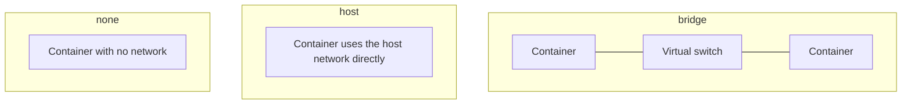
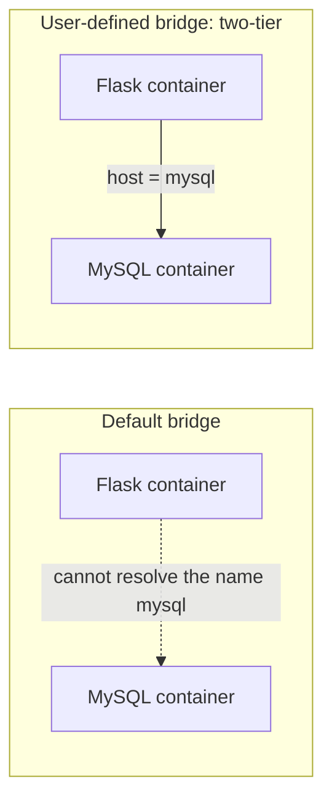
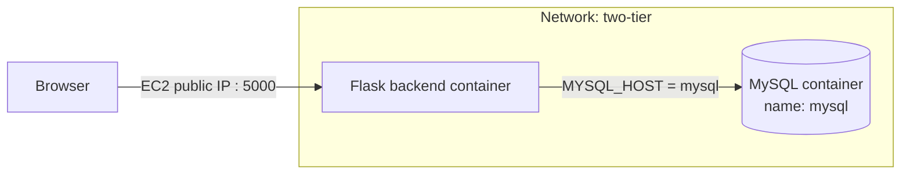
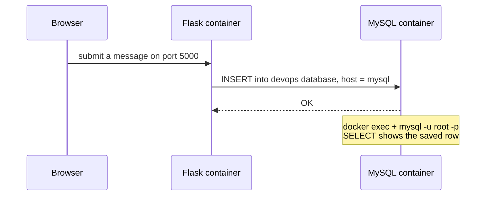
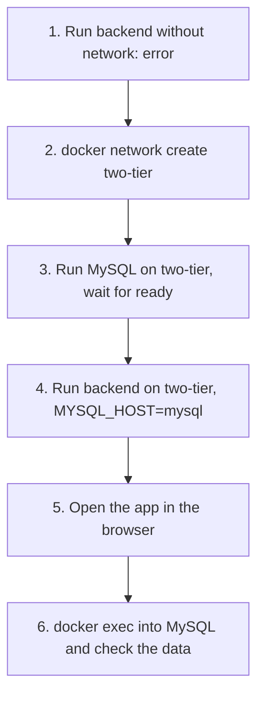

# Docker Networking

## Table of Contents
- [What is a Docker network?](#what-is-a-docker-network)
- [Types of Docker networks](#types-of-docker-networks)
- [Default bridge vs user-defined bridge](#default-bridge-vs-user-defined-bridge)
- [Network commands](#network-commands)
- [Project: two-tier Flask app with MySQL](#project-two-tier-flask-app-with-mysql)
- [Errors I ran into](#errors-i-ran-into)
- [Cleanup](#cleanup)
- [Commands used](#commands-used)

---

## What is a Docker network?

A Docker network is a **virtual network** created by Docker so that containers can communicate with each other, with the host machine, and with the outside world.

Each container gets its own isolated network setup (its own IP address and network interface). The network it is attached to decides **who it can talk to**.

```
┌──────────────── EC2 host ─────────────────┐
│                                           │
│   ┌──────────── Docker network ─────────┐ │
│   │  Container A      Container B       │ │
│   │  172.18.0.2  <->  172.18.0.3        │ │
│   └─────────────────────────────────────┘ │
│                                           │
└───────────────────────────────────────────┘
```

Why it matters: a real app is rarely one container. A web backend needs to reach a database, and the network is what lets them find each other, while keeping everything else out.

---

## Types of Docker networks

| Driver | What it does | Typical use |
|---|---|---|
| **bridge** | Private virtual network on one host. Containers get private IPs and can reach each other; the outside world reaches them only through published ports (`-p`). This is the default. | Most apps on a single machine |
| **host** | Container shares the host's network directly: no separate IP, no isolation. `-p` isn't needed. | Performance, simple setups |
| **none** | No network at all, only a loopback interface. | Fully isolated tasks |
| **overlay** | Connects containers running on **different machines** as one network. | Docker Swarm, multi-host setups |
| **macvlan** | Gives a container its own MAC and IP on the physical network, so it looks like a separate device on the LAN. | Apps that must appear as real devices on a network |



For this note, only **bridge** is used.

---

## Default bridge vs user-defined bridge

Docker creates a default bridge network called `bridge`. I can also create my own. The difference is important:

| | Default `bridge` | User-defined bridge |
|---|---|---|
| Created by | Docker automatically | Me, with `docker network create` |
| Containers reach each other by | **IP address only** | **Container name** (built-in DNS) |
| Isolation | All containers without a network setting share it | Only containers attached to it can talk |
| Use for | Quick tests | Real multi-container apps |

On a user-defined network, Docker runs a small internal DNS service, so a container named `mysql` can be reached simply with the hostname `mysql`. IP addresses change every time a container is recreated, which is why names are much better than IPs.



---

## Network commands

### List networks

```bash
docker network ls
```

A fresh install shows three networks:

```
NETWORK ID     NAME      DRIVER    SCOPE
xxxxxxxxxxxx   bridge    bridge    local
xxxxxxxxxxxx   host      host      local
xxxxxxxxxxxx   none      null      local
```

| Column | Meaning |
|---|---|
| NAME | Network name |
| DRIVER | The type (bridge, host, null for none, overlay...) |
| SCOPE | `local` means it exists on this host only |

### Create a network

```bash
docker network create mynetwork -d bridge
```

| Part | Meaning |
|---|---|
| `docker network create` | Create a new network |
| `mynetwork` | The name I chose |
| `-d bridge` | `-d` is short for `--driver`: the type of network. `bridge` is the default, so `-d bridge` can be left out |

### Inspect a network

```bash
docker network inspect mynetwork
```

Shows the network's full details as JSON (trimmed example, the subnet will differ):

```json
[
    {
        "Name": "mynetwork",
        "Driver": "bridge",
        "Scope": "local",
        "IPAM": {
            "Config": [ { "Subnet": "172.18.0.0/16", "Gateway": "172.18.0.1" } ]
        },
        "Containers": {}
    }
]
```

| Field | Meaning |
|---|---|
| Driver | Network type |
| Subnet | The range of private IPs handed out to containers |
| Gateway | The network's own address, used to reach outside |
| Containers | Containers attached to the network, with their IPs. Empty until I attach some |

Once containers are attached, `Containers` lists each one with its name and IP. That's a quick way to confirm they are on the same network.

---

## Project: two-tier Flask app with MySQL

A **two-tier** application has two layers:

- **Application tier:** the Flask backend (`two-tier-backend`)
- **Data tier:** the MySQL database



The backend image (`two-tier-backend`) is built from the project's Dockerfile with `docker build -t two-tier-backend .`, as in the earlier Dockerfile note.

### Step 1: Run the backend without a network (it fails)

First I ran the Flask container **without** putting it on a shared network with MySQL. The app starts, but it can't connect to the database, and an error shows up.

Why it fails: with no shared user-defined network, the backend has no way to resolve the hostname `mysql`. It doesn't know where the database is. (Even if both containers sit on the default bridge, names are not resolved there, only IPs.) The exact wording of the error depends on the database library the app uses, but it says it can't connect to or can't find the MySQL host.

This failure is the reason networks are needed.

### Step 2: Create a network

```bash
docker network create two-tier -d bridge
```

Creates a user-defined bridge network named `two-tier`. Check it with:

```bash
docker network ls
docker network inspect two-tier
```

### Step 3: Start the MySQL container on the network

```bash
docker run -d --name mysql --network two-tier -e MYSQL_ROOT_PASSWORD=root -e MYSQL_DATABASE=devops mysql
```

| Part | Meaning |
|---|---|
| `-d` | Run in the background |
| `--name mysql` | Container name. On a user-defined network this name works as the **hostname** |
| `--network two-tier` | Attach it to the `two-tier` network |
| `-e MYSQL_ROOT_PASSWORD=root` | Password for the MySQL `root` user (required by the image) |
| `-e MYSQL_DATABASE=devops` | Makes the image create a database called `devops` on first startup |
| `mysql` | The image |

There is no `-p` on purpose. The database is not published to the outside world. Only containers on `two-tier` can reach it, which is safer.

MySQL takes a while to initialize on first start. Before starting the backend, wait until this shows "ready for connections":

```bash
docker logs mysql
```

### Step 4: Start the backend container on the same network

```bash
docker run -d -p 5000:5000 --network two-tier -e MYSQL_HOST=mysql -e MYSQL_USER=root -e MYSQL_PASSWORD=root -e MYSQL_DB=devops two-tier-backend:latest
```

| Part | Meaning |
|---|---|
| `-d` | Run in the background |
| `-p 5000:5000` | Host port 5000 to container port 5000, so the app is reachable at `http://<EC2-public-IP>:5000` (the EC2 security group must allow port 5000) |
| `--network two-tier` | Same network as MySQL, so the two can talk |
| `-e MYSQL_HOST=mysql` | Where the database is: the **container name** from Step 3, no IP needed |
| `-e MYSQL_USER=root` | User the app logs in as |
| `-e MYSQL_PASSWORD=root` | Must match `MYSQL_ROOT_PASSWORD` |
| `-e MYSQL_DB=devops` | Must match `MYSQL_DATABASE` |
| `two-tier-backend:latest` | The backend image I built (`name:tag`) |

The `-e` flags set **environment variables** inside the container. The app reads them in code instead of hardcoding connection details, for example:

```python
host = os.environ["MYSQL_HOST"]
```

so the same image works in any environment just by changing the variables.

Check that both containers are running and attached to the network:

```bash
docker ps
docker network inspect two-tier      # "Containers" should list both
docker logs <backend_container_id>
```

Then open `http://<EC2-public-IP>:5000` in a browser and use the app (for example submit a message).

### Step 5: Verify the data inside MySQL

Open a shell inside the running MySQL container:

```bash
docker exec -it container_id bash
```

(the container name `mysql` works in place of the ID: `docker exec -it mysql bash`)

| Part | Meaning |
|---|---|
| `docker exec` | Run a command inside a **running** container |
| `-i` | Keep input open |
| `-t` | Give it a terminal |
| `bash` | The command to run: a shell |

Inside the container, log in to MySQL:

```bash
mysql -u root -p
```

`-u root` is the user, and `-p` makes it ask for the password (type `root`). Then check the data:

```sql
SHOW DATABASES;            -- devops should be listed
USE devops;                -- switch to the devops database
SHOW TABLES;               -- tables created by the app
SELECT * FROM <table>;     -- use the table name shown above
```

The rows I submitted through the web page showing up here confirm the whole chain works: browser, Flask backend, network, MySQL.



Leave MySQL with `exit` (twice: once for the MySQL prompt, once for the container shell).

### Steps at a glance



---

## Errors I ran into

| Problem | Cause | Fix |
|---|---|---|
| Backend can't connect to MySQL (no network) | No shared user-defined network, so the name `mysql` can't be resolved | Create a network and start both containers on it |
| MySQL container exits during first startup on EC2 | Small instance ran out of RAM (the process was killed) | Add swap space or use a bigger instance type |
| `Control server error: [Errno 13] Permission denied: '/home/appuser'` in the backend logs | Newer gunicorn versions create a control socket by default, and the non-root user in the container has no writable home folder. The app itself keeps running | Disable it by adding `--no-control-socket` to gunicorn's command, or give the user a writable home (`useradd -m`, or `-e HOME=/tmp`) |

---

## Cleanup

```bash
docker stop mysql <backend_container_id>
docker rm mysql <backend_container_id>
docker network rm two-tier
```

A network can only be removed when no container is using it, so remove the containers first. Data inside the MySQL container is lost when it's removed unless a volume is used (a good next topic).

To remove all unused networks at once:

```bash
docker network prune
```

---

## Commands used

| Command | Purpose |
|---|---|
| `docker network ls` | List networks |
| `docker network create name -d bridge` | Create a bridge network |
| `docker network inspect name` | Show a network's details and attached containers |
| `docker network connect name container` | Attach a running container to a network |
| `docker network disconnect name container` | Detach a container from a network |
| `docker network rm name` | Delete a network |
| `docker network prune` | Delete all unused networks |
| `docker run --network name ...` | Start a container attached to a network |
| `docker run --name x ...` | Give the container a name (also its hostname on a user-defined network) |
| `docker exec -it container bash` | Open a shell inside a running container |
| `mysql -u root -p` | Log in to MySQL from inside the MySQL container |
| `docker logs container` | Show a container's logs |
