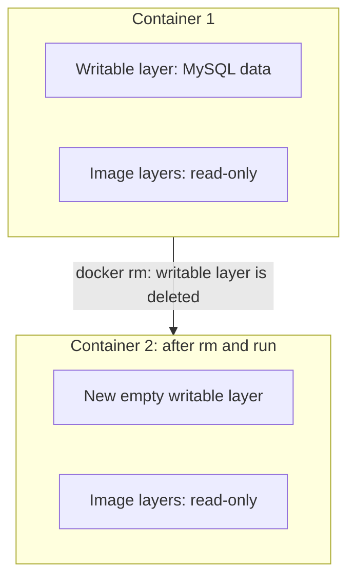
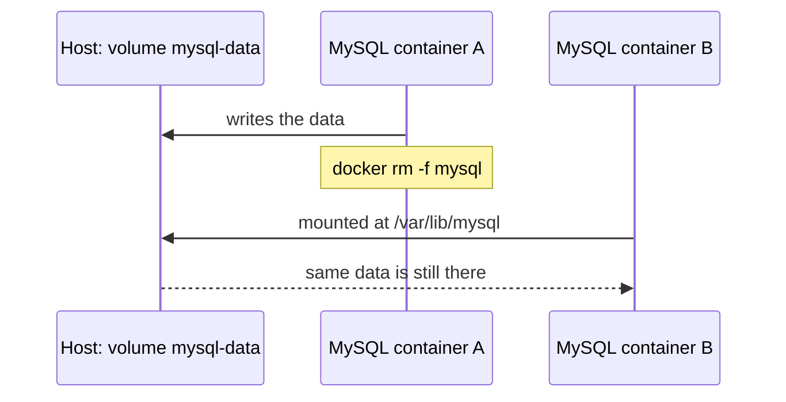

# Docker Volumes and Storage

## Table of Contents
- [The problem: data disappears with the container](#the-problem-data-disappears-with-the-container)
- [The solution: volumes](#the-solution-volumes)
- [Types of storage in Docker](#types-of-storage-in-docker)
- [Part 1: Named volume](#part-1-named-volume)
- [Part 2: Bind mount (a host directory)](#part-2-bind-mount-a-host-directory)
- [Named volume vs bind mount](#named-volume-vs-bind-mount)
- [Things to watch](#things-to-watch)
- [Cleanup](#cleanup)
- [Commands used](#commands-used)

---

## The problem: data disappears with the container

In the previous two-tier example, MySQL stored its data **inside the container**. What happens to that data depends on what I do to the container:

| Action | Data |
|---|---|
| `docker stop` then `docker start` (restart) | **Still there** |
| `docker rm` and then `docker run` again | **Gone** |

Why: every container has its own thin **writable layer** on top of the image's read-only layers. Everything the container writes lands in that layer. Stopping a container keeps the layer, so a restart still finds the data. Removing the container **deletes the layer**, and the new container starts with a fresh one.



For a database that is a real problem, since data must survive deleting, recreating, or upgrading the container. That's why Docker has volumes.

---

## The solution: volumes

A **volume** is storage that lives **outside the container's writable layer**, on the host machine, and is mounted into the container at a path. The container reads and writes there as if it were a normal folder, but the data is kept on the host, so it survives even when the container is deleted.

```
 Host machine                         Container
┌──────────────────────────┐        ┌──────────────────────┐
│ /var/lib/docker/volumes/ │        │                      │
│   mysql-data/_data  <────┼────────┼──>  /var/lib/mysql   │
│   (data lives here)      │ mounted│   (MySQL writes here)│
└──────────────────────────┘        └──────────────────────┘
      stays after docker rm
```

`/var/lib/mysql` is the folder where MySQL keeps its database files **inside the container**. Mounting a volume there means all of MySQL's data goes to the host instead.

The flag used is `-v` (volume), written as `host-side:container-side`.

---

## Types of storage in Docker

| Type | What it is | Managed by |
|---|---|---|
| **Named volume** | Storage created and managed by Docker, in a Docker-controlled location on the host | Docker |
| **Bind mount** | A directory I create on the host and mount into the container | Me |
| **tmpfs mount** | Stored in the host's memory only, never on disk. Gone when the container stops (extra info, used for temporary or sensitive data) | Docker |

Both named volumes and bind mounts use the `-v` flag, and Docker tells them apart by what is written on the left side:

```bash
-v mysql-data:/var/lib/mysql                 # left side is a name      -> named volume
-v /home/ubuntu/volumes/mysql:/var/lib/mysql # left side is a full path -> bind mount
```

(There is also a longer `--mount` syntax that spells the type out, but `-v` is what I'm using.)

---

## Part 1: Named volume

### Step 1: Create the volume

```bash
docker volume create mysql-data
```

Creates a volume named `mysql-data`. This step is optional, since `docker run -v mysql-data:...` creates the volume automatically if it doesn't exist, but creating it first makes the flow clear.

### Step 2: List volumes

```bash
docker volume ls
```

```
DRIVER    VOLUME NAME
local     mysql-data
```

`local` means the data is stored on this host.

### Step 3: Find where it lives on the host

```bash
docker inspect mysql-data
```

(`docker volume inspect mysql-data` is the same thing and more explicit.) The output is JSON, and the key line is `Mountpoint`:

```json
[
    {
        "CreatedAt": "2026-11-09T12:00:00Z",
        "Driver": "local",
        "Mountpoint": "/var/lib/docker/volumes/mysql-data/_data",
        "Name": "mysql-data",
        "Scope": "local"
    }
]
```

| Field | Meaning |
|---|---|
| Name | The volume's name |
| Driver | `local`: stored on this machine |
| Mountpoint | The **path on the host** where the data actually lives |

### Step 4: Run MySQL with the volume

```bash
docker run -d --name mysql --network two-tier -v mysql-data:/var/lib/mysql -e MYSQL_ROOT_PASSWORD=root -e MYSQL_DATABASE=devops mysql
```

The only new part compared with before is the `-v` flag:

| Part | Meaning |
|---|---|
| `-v` | Mount a volume or directory |
| `mysql-data` | The volume on the host side |
| `:` | Separator |
| `/var/lib/mysql` | The path **inside the container** where MySQL stores its data |

Start the backend as before:

```bash
docker run -d -p 5000:5000 --network two-tier -e MYSQL_HOST=mysql -e MYSQL_USER=root -e MYSQL_PASSWORD=root -e MYSQL_DB=devops two-tier-backend:latest
```

### Step 5: Check the data on the host

The volume directory is owned by root, so switch to root (or put `sudo` in front of each command):

```bash
sudo su
cd /var/lib/docker/volumes/mysql-data/_data     # the Mountpoint from Step 3
ls
```

`ls` shows MySQL's own files, such as `ibdata1`, `mysql.ibd`, and folders including `devops` (the database I created with `MYSQL_DATABASE`). That is the database living on the **host**, not inside the container. Type `exit` to leave root.

### Step 6: Prove the data survives deleting the container

1. Use the app to save some data (for example submit a message on the web page), or check inside MySQL:

```bash
docker exec -it mysql mysql -u root -p
```

```sql
USE devops;
SHOW TABLES;
SELECT * FROM <table>;
```

2. Delete the MySQL container completely:

```bash
docker rm -f mysql
```

3. Start a new one with the **same volume**:

```bash
docker run -d --name mysql --network two-tier -v mysql-data:/var/lib/mysql -e MYSQL_ROOT_PASSWORD=root -e MYSQL_DATABASE=devops mysql
```

4. Check again with the same SQL as in step 1. The table and the rows are still there, because the new container picked up the old data from the volume.



---

## Part 2: Bind mount (a host directory)

The second way is to **choose the folder myself** instead of letting Docker manage it.

### Step 1: Create a directory and get its full path

```bash
mkdir -p /home/ubuntu/volumes/mysql
cd /home/ubuntu/volumes/mysql
pwd
```

`pwd` prints the full path, `/home/ubuntu/volumes/mysql`. A bind mount needs the **absolute path** (starting with `/`).

### Step 2: Run MySQL with that directory

```bash
docker run -d --name mysql --network two-tier -v /home/ubuntu/volumes/mysql:/var/lib/mysql -e MYSQL_ROOT_PASSWORD=root -e MYSQL_DATABASE=devops mysql
```

| Part | Meaning |
|---|---|
| `/home/ubuntu/volumes/mysql` | Host side: my own directory |
| `/var/lib/mysql` | Container side: where MySQL keeps its data |

### Step 3: Check the data on the host

```bash
ls /home/ubuntu/volumes/mysql
```

The same MySQL files appear here. Because the folder is in my own home directory, there's no need to hunt for a path with `docker inspect`, and I can browse, back up or copy it directly. The files may be owned by a different user ID (MySQL's user inside the container), so `sudo ls` may be needed to see everything.

Deleting the container and starting a new one with the same `-v` path keeps the data, exactly as in Part 1.

---

## Named volume vs bind mount

| | Named volume | Bind mount |
|---|---|---|
| Created with | `docker volume create` (or auto-created by `-v name:...`) | `mkdir` (my own directory) |
| Location on host | Chosen by Docker (`/var/lib/docker/volumes/name/_data`) | Wherever I put it |
| Managed through | `docker volume ls / inspect / rm` | Normal file commands |
| Written as | `-v mysql-data:/var/lib/mysql` | `-v /home/ubuntu/volumes/mysql:/var/lib/mysql` |
| Depends on host folder layout | No | Yes, the path must exist on that machine |
| Good for | Databases and app data (the usual choice) | Sharing source code or config files with a container, easy access to the files |

---

## Things to watch

- **Use the same volume or directory, or the data won't be there.** A different volume name or path means a different, empty storage.
- **MySQL only initializes on an empty data folder.** `MYSQL_ROOT_PASSWORD` and `MYSQL_DATABASE` are applied only the first time. If the volume already has data, those values are ignored, so changing the password in `docker run` later won't change the real password.
- **Use a fresh, empty directory for a bind mount.** MySQL fails to initialize if the folder already contains other files.
- **Why the data seemed to vanish before:** the official `mysql` image declares `/var/lib/mysql` as a volume itself. When no `-v` is given, Docker silently creates an **anonymous volume** with a random-hash name. A new container gets a new anonymous volume, so the data looks gone even though the old one still exists (check with `docker volume ls`). Naming the volume is what makes it reusable.
- **A volume is not a backup.** It protects against deleting the container, not against deleting the volume itself or the disk failing.
- **On Docker Desktop (Windows)** the volume path lives inside the WSL 2 virtual disk, not a normal Windows folder. The `/var/lib/docker/volumes/...` path in this note is for Linux hosts like the EC2 instance.

---

## Cleanup

```bash
docker rm -f mysql                 # remove the container first
docker volume rm mysql-data        # then remove the volume
```

A volume can't be removed while a container (even a stopped one) is using it. **Removing a volume permanently deletes its data.**

```bash
docker volume prune
```

removes volumes that no container is using. Depending on the Docker version it may remove only anonymous volumes unless `-a` is added, and it asks for confirmation, so read what it lists before saying yes. A bind-mounted directory is just a normal folder, so remove it with `rm -r` when no longer needed.

---

## Commands used

| Command | Purpose |
|---|---|
| `docker volume ls` | List volumes |
| `docker volume create name` | Create a named volume |
| `docker volume inspect name` / `docker inspect name` | Show details, including the host path (`Mountpoint`) |
| `docker volume rm name` | Delete a volume (and its data) |
| `docker volume prune` | Delete unused volumes |
| `docker run -v name:/path/in/container ...` | Mount a named volume |
| `docker run -v /host/path:/path/in/container ...` | Mount a host directory (bind mount) |
| `sudo su` | Switch to root to read the volume directory |
| `mkdir -p dir`, `pwd` | Create a host directory and get its full path |
| `docker exec -it mysql mysql -u root -p` | Open MySQL inside the container to check the data |
