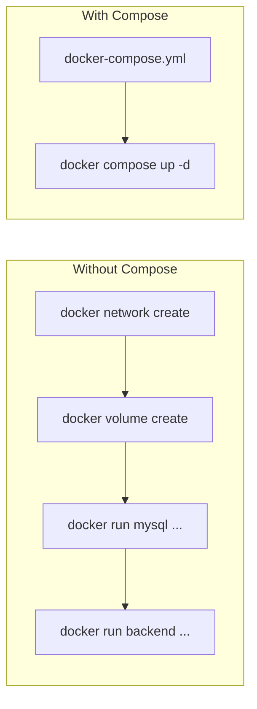
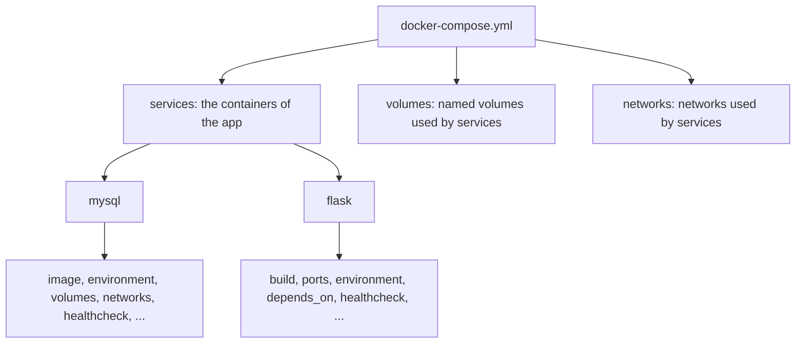
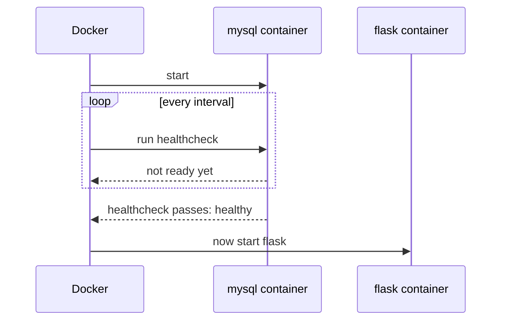

# Docker Compose

## Table of Contents
- [What is Docker Compose?](#what-is-docker-compose)
- [What is YAML?](#what-is-yaml)
- [Structure of a Compose file](#structure-of-a-compose-file)
- [Template](#template)
- [Keys explained](#keys-explained)
- [depends_on vs healthcheck](#depends_on-vs-healthcheck)
- [Installing Docker Compose](#installing-docker-compose)
- [Running it](#running-it)
- [up vs up --build](#up-vs-up---build)
- [Removing images](#removing-images)
- [Names Compose creates](#names-compose-creates)
- [Common mistakes](#common-mistakes)
- [Commands used](#commands-used)

---

## What is Docker Compose?

Docker Compose is a tool that lets me define a **multi-container application in one file** and run it with a single command.

Without Compose, the two-tier app needs a network, a volume, and two long `docker run` commands, all typed in the right order. With Compose, all of that is written once in a `docker-compose.yml` file, so the setup is automated and repeatable. Anyone who clones the repo can start the same app.



So it's a **tool** (the `docker compose` command) that is driven by a **config file** (`docker-compose.yml`).

---

## What is YAML?

YAML is a human-readable text format for writing configuration. The Compose file is written in YAML, which is why the file ends in `.yml` or `.yaml`.

It is made of **key-value pairs**:

```yaml
key: value
```

Three building blocks cover everything in a Compose file:

| Building block | Looks like | Meaning |
|---|---|---|
| Key-value pair | `restart: always` | A setting and its value |
| Nested keys (mapping) | a key followed by indented keys underneath | A group of related settings |
| List | lines starting with `- ` | Several values for one key |

```yaml
# a comment

name: devops                 # key: value

database:                    # nested keys, indented under the parent
  host: mysql
  user: root

ports:                       # a list
  - "5000:5000"
  - "3306:3306"
```

Rules:
- **Indentation shows structure.** Children are indented under their parent (2 spaces is common).
- **Spaces only, never tabs.** A tab causes an error.
- A **space is required after the colon** in `key: value`.
- `#` starts a comment.
- Items in the same group must have the **same indentation**.

Most YAML errors come from wrong indentation, so that's the first thing to check when Compose complains.

---

## Structure of a Compose file

A Compose file has a few **top-level keys**. The main ones are `services`, `volumes` and `networks`:



- **`services`** is where the app is described. Each entry is one service (usually one container), and the entry's name is the **service name**.
- **`volumes`** and **`networks`** at the bottom **declare** the named volumes and networks that services refer to. A service can only use a volume or network that is declared there (or already exists and is marked `external`).

---

## Template

This is the general shape of the file, with placeholders instead of real values:

```yaml
services:
  <service-name>:
    image: <image>:<tag>
    # or, to build from a Dockerfile:
    build:
      context: <folder-with-Dockerfile>
    container_name: <optional-name>
    ports:
      - "<host-port>:<container-port>"
    environment:
      <VARIABLE>: <value>
    volumes:
      - <volume-name>:<path-inside-container>
    networks:
      - <network-name>
    depends_on:
      <other-service>:
        condition: service_healthy
    restart: <policy>
    healthcheck:
      test: <command>
      interval: <time>
      timeout: <time>
      retries: <number>
      start_period: <time>

  <another-service>:
    ...

volumes:
  <volume-name>:

networks:
  <network-name>:
```

Every service follows the same pattern, so a new container is just another block under `services:`.

---

## Keys explained

### Top level

| Key | Purpose |
|---|---|
| `services` | The parts of the application. Each service normally runs as one container (it can be scaled to more). **Required** |
| `volumes` | Declares the named volumes that services use. Docker creates and manages them |
| `networks` | Declares the networks that services use. If left out, Compose creates one default network for the project |
| `version` | Old format version, such as `"3.8"`. It is now obsolete: current Compose ignores it and may warn, so it can be left out |

### Inside a service

| Key | Purpose | `docker run` equivalent |
|---|---|---|
| service name (e.g. `mysql`) | Identifies the service. Also the **hostname** other services use to reach it | n/a |
| `image` | Ready-made image to use (`name:tag`) | the image name |
| `build` / `context` | Build the image from a Dockerfile in this folder | `docker build` |
| `container_name` | Optional fixed name for the container. If left out, Compose generates one | `--name` |
| `ports` | Publish a port: `"host:container"` | `-p` |
| `environment` | Environment variables passed into the container | `-e` |
| `volumes` | Mount a named volume or host folder: `source:path-in-container` | `-v` |
| `networks` | Networks to attach the service to | `--network` |
| `depends_on` | Start order between services | n/a |
| `restart` | What to do when the container stops | `--restart` |
| `healthcheck` | A command Docker runs inside the container to check it's working | n/a |

Notes on the less obvious ones:
- **`image` vs `build`:** use `image` for something that already exists (Docker Hub or built earlier), and `build` to create the image from my own Dockerfile. If both are given, `image` becomes the name of the built image.
- **`ports`:** write them in quotes (`"5000:5000"`), since unquoted `xx:yy` values can be misread by YAML. A port is only needed to reach a service **from outside** the Docker network. Containers on the same network reach each other directly, so the database doesn't need a `ports` entry.
- **`environment`:** can be written as `KEY: value` pairs, or as a list (`- KEY=value`).
- **`restart`:** `no` (default), `on-failure`, `always`, `unless-stopped`.
- **`services` is not "number of containers".** It's the list of application components. Each one runs as a container by default.

### `healthcheck` keys

| Key | Purpose |
|---|---|
| `test` | The command to run inside the container. Exit code 0 = healthy, anything else = failed. `["CMD", ...]` runs it directly; `["CMD-SHELL", "..."]` runs it through a shell (needed for things like `$VARIABLE`) |
| `interval` | How often to run the check |
| `timeout` | How long a single check may take before it counts as failed |
| `retries` | Number of failures in a row before the container is marked `unhealthy` |
| `start_period` | Startup grace time. Failures during it don't count |

Inside a Compose file, a literal `$` must be written as `$$`. Otherwise Compose tries to substitute the variable itself before the container sees it.

---

## depends_on vs healthcheck

The short form of `depends_on` only controls **start order**, and not readiness:

```yaml
depends_on:
  - mysql
```

It starts the backend as soon as the MySQL container has *started*, but MySQL needs a while after that to initialize. The backend can try to connect too early and fail. So `depends_on` alone doesn't solve the problem.

(It also doesn't affect building. It only decides the order in which containers are started.)

The fix is a **healthcheck on the database** plus the long form of `depends_on`, which waits until the dependency is healthy:

```yaml
depends_on:
  mysql:
    condition: service_healthy
```



Docker only **marks** a container unhealthy. It doesn't restart it for that reason, so health status is mainly for `depends_on` and for me to read in `docker ps` / `docker compose ps`.

---

## Installing Docker Compose

Compose v2 is a plugin for the `docker` command, so it's used as `docker compose` (with a space). If `docker compose` says `unknown command`, it isn't installed.

```bash
sudo apt-get install docker-compose-plugin
```

The package name depends on where Docker was installed from:
- `docker-compose-plugin` comes from **Docker's own apt repository**.
- With Docker installed through Ubuntu's `docker.io` package, the matching package is usually **`docker-compose-v2`**. (A typo like `docker-composev2` gives `Unable to locate package`.)

Check that it worked:

```bash
docker compose version
```

It should print `Docker Compose version v2.x.x`. Running `docker compose --version` when it isn't installed prints the Docker version instead, which is misleading.

Docker Desktop on Windows already includes Compose.

The old hyphenated command `docker-compose` is Compose v1 and is no longer maintained.

---

## Running it

```bash
docker compose up
```

Creates the network and volumes, builds images if needed, and starts all the services. It runs in the **foreground** and shows logs, and `Ctrl+C` stops the containers.

```bash
docker compose up -d
```

`-d` is **detached mode**: everything runs in the background and the terminal stays free.

```bash
docker compose down
```

**Stops and removes** all the containers, and also removes the network Compose created. **Named volumes are kept**, so the data survives. To delete the volumes too:

```bash
docker compose down -v
```

| Command | Containers | Network | Volumes (data) |
|---|---|---|---|
| `docker compose stop` | Stopped, kept | Kept | Kept |
| `docker compose down` | Removed | Removed | Kept |
| `docker compose down -v` | Removed | Removed | **Deleted** |

Other useful ones:

```bash
docker compose ps              # containers of this project and their state
docker compose logs -f flask   # follow one service's logs
docker compose config          # validate the file and show where it's wrong
```

---

## up vs up --build

`--build` only affects services with a `build:` section. Services that just use `image:` are not affected.

| | `docker compose up -d` | `docker compose up -d --build` |
|---|---|---|
| Image doesn't exist yet | Builds it | Builds it |
| Image already exists | **Reuses it**, even if the code changed | **Rebuilds** it, then starts |
| Use when | Nothing in the code or Dockerfile changed | Code, `requirements.txt` or Dockerfile changed |

Plain `up` never looks at the code. It only checks whether an image already exists. That's why editing the code and running `docker compose up -d` shows no change, and `--build` is needed to create the new image.

---

## Removing images

List the IDs of all images:

```bash
docker images -aq
```

| Flag | Meaning |
|---|---|
| `-a` | **All** images, including the intermediate layers that are normally hidden |
| `-q` | **Quiet**: print only the image IDs, without the table |

Remove all of them in one go:

```bash
docker rmi -f $(docker images -aq)
```

- `$(...)` runs the inner command first and puts its output (the list of IDs) into the outer command.
- `docker rmi` removes images, and `-f` forces it.

This is a general Docker cleanup, not a Compose command. Be careful with it:
- It removes **every** image on the machine, so anything needed again has to be pulled or rebuilt.
- Images used by **running** containers can't be removed even with `-f`, so run `docker compose down` first (and remove other containers) before using it.
- If there are no images, the command prints an error about "requires at least 1 argument". That's harmless.

Gentler options:

```bash
docker image prune        # only dangling images (old untagged leftovers)
docker image prune -a     # all images not used by any container
```

---

## Names Compose creates

Compose prefixes resources with the **project name**, which is the **folder name** by default (for `two-tier-flask-app`):

| Resource | Pattern | Example |
|---|---|---|
| Network | `<project>_<network>` | `two-tier-flask-app_two-tier` |
| Volume | `<project>_<volume>` | `two-tier-flask-app_mysql-data` |
| Container | `<project>-<service>-<number>` | `two-tier-flask-app-flask-1` |

`container_name` overrides the container name. The service name itself isn't prefixed, and it's what works as the hostname inside the network. Because of the prefix, a Compose volume called `mysql-data` is a **different volume** from one with the same name created earlier with `docker volume create`.

---

## Common mistakes

| Mistake | Result |
|---|---|
| Tabs or wrong indentation | YAML parse error. Check with `docker compose config` |
| Healthcheck keys (`interval`, `retries`...) not aligned with `test` | Parse error, or the settings are ignored |
| Using only `depends_on: - mysql` | Backend may start before the database is ready |
| Healthcheck URL `/health` doesn't exist in the app | Container stays `unhealthy` |
| Editing code and running `up -d` without `--build` | Old code keeps running |
| Old container with the same `container_name` still exists | `name already in use` error. Remove it with `docker rm -f name` |
| `down -v` run by habit | Database data is deleted |

---

## Commands used

| Command | Purpose |
|---|---|
| `sudo apt-get install docker-compose-plugin` | Install Compose (or `docker-compose-v2` on Ubuntu's own repos) |
| `docker compose version` | Check Compose is installed |
| `docker compose up` | Create and start everything in the foreground |
| `docker compose up -d` | Same, in the background |
| `docker compose up -d --build` | Rebuild images first, then start |
| `docker compose down` | Stop and remove containers and the network (volumes kept) |
| `docker compose down -v` | Same, and delete the volumes |
| `docker compose ps` | List the project's containers |
| `docker compose logs -f service` | Follow a service's logs |
| `docker compose config` | Validate the Compose file |
| `docker images -aq` | List the IDs of all images |
| `docker rmi -f $(docker images -aq)` | Force-remove all images |
