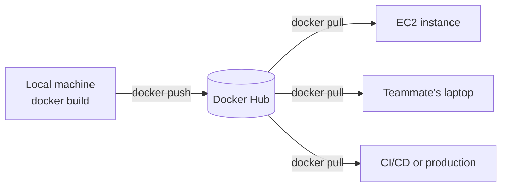
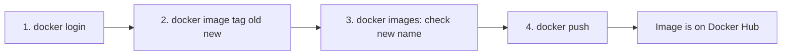
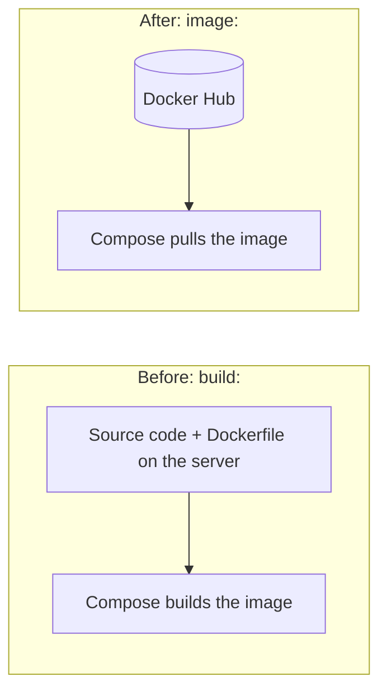
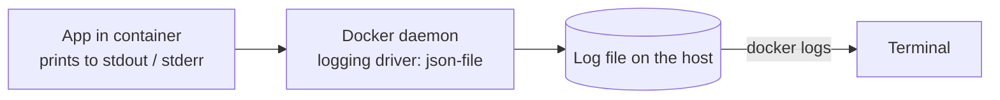
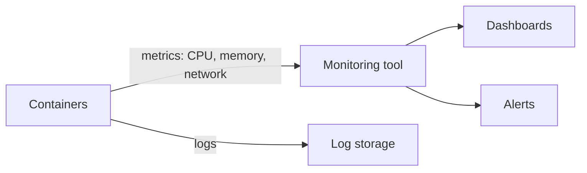

# Docker Registry, Logging and Monitoring

## Table of Contents
- [Part 1: Docker registry](#part-1-docker-registry)
  - [What is a registry?](#what-is-a-registry)
  - [Pushing an image to Docker Hub](#pushing-an-image-to-docker-hub)
  - [Pulling the image](#pulling-the-image)
  - [Using the pushed image in docker-compose.yml](#using-the-pushed-image-in-docker-composeyml)
- [Part 2: Logging and monitoring](#part-2-logging-and-monitoring)
  - [What is logging?](#what-is-logging)
  - [docker logs](#docker-logs)
  - [Redirecting logs into a file](#redirecting-logs-into-a-file)
  - [Log size and rotation](#log-size-and-rotation)
  - [What is monitoring?](#what-is-monitoring)
  - [Monitoring commands and tools](#monitoring-commands-and-tools)
- [Commands used](#commands-used)

---

# Part 1: Docker registry

## What is a registry?

A **registry** is a server that **stores and distributes Docker images**. Pushing uploads an image to it, and pulling downloads an image from it.

**Docker Hub** is Docker's public registry and the default one. When I run `docker pull mysql`, the image comes from Docker Hub. Companies also use private registries such as AWS ECR or GitHub Container Registry.

Registry vs Docker Hub is like Git vs GitHub: the registry is the concept, and Docker Hub is one service that provides it.

Inside a registry, images are grouped into **repositories**. A repository is the collection of versions (tags) of one image:

```
Docker Hub
 └─ username
     └─ repository: two-tier-backend
          ├─ tag 1.0
          ├─ tag 1.1
          └─ tag latest
```

Full image name:

```
<username> / <repository> : <tag>
sujal      / two-tier-backend : 1.0
```

The **tag** is a version label. If no tag is given, Docker uses `latest`, which is only a default name and not a guarantee of "newest".

### Why push images?

Without a registry, every machine has to build the image itself. With one, I **build once and run anywhere**:



---

## Pushing an image to Docker Hub



### Step 1: Log in to Docker Hub

```bash
docker login
```

Asks for the Docker Hub username and password. If I don't remember the password, a **PAT (personal access token)** generated from Docker Hub can be used in its place. A PAT is safer, since it can be revoked without changing the account password.

### Step 2: Tag the image

```bash
docker image tag old_name:tag username/new_name:tag
```

For example:

```bash
docker image tag two-tier-backend:latest <username>/two-tier-backend:1.0
```

| Part | Meaning |
|---|---|
| `docker image tag` | Gives an existing image an additional name (same as `docker tag`) |
| `old_name:tag` | The local image that already exists |
| `username/new_name:tag` | The new name. It **must start with my Docker Hub username** (namespace), or the push is denied |

Tagging doesn't copy the image or use extra disk. It only adds another label pointing to the same image.

### Step 3: Check the new name

```bash
docker images
```

The new name now appears in the list, and it shows the same IMAGE ID as the old one:

```
REPOSITORY                     TAG      IMAGE ID
two-tier-backend               latest   b7c1d2e3f4a5
<username>/two-tier-backend    1.0      b7c1d2e3f4a5     <- same image, new name
```

### Step 4: Push the image

```bash
docker push username/new_name:tag
```

Uploads the image to Docker Hub, layer by layer. Layers that already exist on Docker Hub are skipped, so later pushes are faster. If the repository doesn't exist yet, it's normally created automatically.

---

## Pulling the image

Once it's pushed, anyone who is allowed to can pull it directly, from any machine:

```bash
docker pull username/new_name:tag
```

Who can pull depends on the repository's visibility:

| | Public repository | Private repository |
|---|---|---|
| Who can pull | **Anyone**, even without logging in | Only me and people I give access to |
| Needs `docker login` | No | Yes |
| Who can push | Only me and collaborators | Only me and collaborators |

Cautions:
- On a public repository anyone can inspect the image's layers, so **never put passwords, `.env` files or keys inside an image**. Pass secrets at runtime instead.
- Pushing the same tag again **replaces** what that tag points to. Use new version tags for new builds.
- Docker Hub applies pull-rate limits to anonymous and free accounts, and private repository counts depend on the plan, so check its current terms.

---

## Using the pushed image in docker-compose.yml

Once the image is on Docker Hub, a service doesn't need to build it. `build:` can be replaced with `image:`:

Before (builds the image from the local Dockerfile):

```yaml
  flask:
    build:
      context: .
```

After (uses the image from Docker Hub):

```yaml
  flask:
    image: username/new_name:tag
```

Now `docker compose up -d` pulls the image if it isn't already on the machine. So a server only needs the `docker-compose.yml` and a way to pull, and no source code or Dockerfile.



To release a change: rebuild, tag with a new version, push, update the tag in the Compose file, and run `docker compose up -d` on the server.

---

# Part 2: Logging and monitoring

## What is logging?

**Logging** is recording what an application prints while it runs: startup messages, requests, errors, stack traces. Logs answer "**what happened?**", and they're the first place to look when a container misbehaves or exits (like the `Permission denied` error from gunicorn or the `TemplateNotFound` error earlier).

Docker captures a container's **stdout and stderr**, which is everything the main process prints, and stores it using a **logging driver**. The default driver is `json-file`, which writes the output to a file on the host.



Important: `docker logs` only shows what the app writes to **stdout/stderr**. If an app writes only to a log file inside the container, `docker logs` shows nothing for it. Containerized apps should print their logs to the console.

---

## docker logs

```bash
docker logs container_id
```

Prints everything the container has output so far. The container can be running or stopped, which is why it's the first command to use on a container that exited.

| Command | What it does |
|---|---|
| `docker logs container_id` | All logs so far |
| `docker logs -f container_id` | **Follows** the logs live (`Ctrl+C` stops watching, not the container) |
| `docker logs --tail 50 container_id` | Only the last 50 lines |
| `docker logs -t container_id` | Adds a timestamp to each line |
| `docker logs --since 10m container_id` | Only the last 10 minutes |

In Compose, use the service name:

```bash
docker compose logs -f flask
```

### docker logs vs docker attach

| | `docker logs` | `docker attach` |
|---|---|---|
| Shows earlier output | Yes | **No**, only new output from the moment I attach |
| Works on stopped containers | Yes | No |
| Risk | None | Forwards my keyboard input and signals to the container, so `Ctrl+C` can stop it. Detach safely with `Ctrl+P` then `Ctrl+Q` |

---

## Redirecting logs into a file

### The command from my notes

```bash
nohup docker attach container_id &
```

| Part | Meaning |
|---|---|
| `docker attach container_id` | Connect to the container's main process and stream its output |
| `nohup` | "No hangup": keeps the command running after the terminal or SSH session closes, and saves the output into a file named `nohup.out` |
| `&` | Runs it in the background so the prompt comes back |

So the container's output keeps being written to `nohup.out`, even after I log out. Read it with:

```bash
tail -f nohup.out
```

### A safer way: docker logs

`docker attach` can interfere with the container (it passes input and signals to it), and it misses everything printed before attaching. `docker logs` is the cleaner tool for saving logs:

```bash
docker logs container_id > app.log 2>&1
```

Saves everything printed so far into `app.log`. To keep following new logs in the background:

```bash
nohup docker logs -f container_id > app.log 2>&1 &
```

| Part | Meaning |
|---|---|
| `>` | Send the output to the file `app.log` |
| `2>&1` | Send error output (stream 2) to the same place as normal output (stream 1) |
| `-f` | Keep following new lines |
| `nohup` and `&` | Keep it running after logout, in the background |

To stop the background job, find it with `jobs` or `ps aux | grep "docker logs"` and use `kill <pid>`. That stops only the log capture, not the container.

### Where Docker keeps the logs itself

With the default `json-file` driver, each container's log is a file on the host. Find it with:

```bash
docker inspect --format '{{.LogPath}}' container_id
```

It's under `/var/lib/docker/containers/` and needs `sudo` to read. The file is deleted when the container is removed.

---

## Log size and rotation

By default the `json-file` driver **never rotates the log file**, so a chatty container can slowly fill the disk, which matters on a small EC2 volume. Limit it in `docker-compose.yml`:

```yaml
    logging:
      driver: json-file
      options:
        max-size: "10m"
        max-file: "3"
```

This keeps at most 3 files of 10 MB each per container, and deletes the oldest. For a single container: `docker run --log-opt max-size=10m --log-opt max-file=3 ...`.

Other logging drivers send logs elsewhere, for example `syslog`, `journald` or `awslogs` (AWS CloudWatch). With some drivers `docker logs` may not show the output, so check the driver's documentation.

---

## What is monitoring?

**Monitoring** is watching the **health and resource usage** of containers over time, such as CPU, memory, network, whether a service is up, and getting alerted when something is wrong. It answers "**how is it doing right now, and is it getting worse?**"

| | Logging | Monitoring |
|---|---|---|
| Records | Events and messages (text) | Numbers and status over time (metrics) |
| Answers | What happened? Why did it fail? | Is it healthy? Is it running out of CPU or memory? |
| Example | A stack trace in the backend | Memory climbing until the container is killed |

They work together. Monitoring shows *that* something is wrong (memory is spiking), and logs show *why*. The MySQL container getting killed on the small EC2 instance earlier is the kind of problem monitoring catches.



---

## Monitoring commands and tools

### Built-in commands

```bash
docker stats
```

Shows a **live table** of resource usage per running container:

```
CONTAINER ID   NAME              CPU %   MEM USAGE / LIMIT    MEM %   NET I/O        BLOCK I/O     PIDS
a1b2c3d4e5f6   two-tier-backend  0.5%    45MiB / 908MiB       4.9%    1.2kB / 800B   0B / 0B       3
```

| Column | Meaning |
|---|---|
| CPU % | Share of CPU the container is using |
| MEM USAGE / LIMIT | Memory used out of the memory available to it (the host's total, unless a limit is set) |
| MEM % | Memory used as a percentage |
| NET I/O | Data received / sent over the network |
| BLOCK I/O | Data read from / written to disk |
| PIDS | Number of processes inside the container |

`docker stats --no-stream` prints one snapshot instead of a live view.

| Command | Purpose |
|---|---|
| `docker stats` | Live CPU, memory, network and disk usage |
| `docker ps` / `docker compose ps` | Which containers are up, and their health status (`healthy` / `unhealthy`) |
| `docker top container_id` | Processes running inside a container |
| `docker inspect container_id` | Full details, including health check results and `OOMKilled` |
| `docker events` | Live stream of Docker events (container start, stop, die, ...) |
| `docker system df` | Disk used by images, containers and volumes |

Health checks (from the Compose note) are part of monitoring too: the `healthy`/`unhealthy` status shows whether the app is actually working, not just running.

### Monitoring tools

| Tool | What it does |
|---|---|
| **cAdvisor** | Collects per-container CPU, memory and network metrics |
| **Prometheus** | Stores metrics over time and supports alert rules |
| **Grafana** | Dashboards and graphs built from Prometheus data |
| **Portainer** | Web UI to view and manage containers, logs and stats |
| **AWS CloudWatch** | Metrics, logs and alarms for EC2 and containers on AWS |
| **Datadog, New Relic, etc.** | Hosted all-in-one monitoring services |

A common open-source setup is **cAdvisor, then Prometheus, then Grafana**.

---

## Commands used

| Command | Purpose |
|---|---|
| `docker login` | Log in to Docker Hub (password or PAT) |
| `docker image tag old:tag username/new:tag` | Add a new name to an existing image |
| `docker images` | List images, including the newly tagged one |
| `docker push username/new:tag` | Upload the image to Docker Hub |
| `docker pull username/new:tag` | Download the image from Docker Hub |
| `docker logs container_id` | Show a container's logs |
| `docker logs -f container_id` | Follow logs live |
| `docker logs --tail 50 container_id` | Last 50 lines |
| `docker logs container_id > app.log 2>&1` | Save logs into a file |
| `nohup docker logs -f container_id > app.log 2>&1 &` | Keep saving logs in the background after logout |
| `nohup docker attach container_id &` | Attach in the background; output goes to `nohup.out` |
| `docker stats` | Live resource usage of containers |
| `docker top container_id` | Processes inside a container |
| `docker events` | Stream of Docker events |
